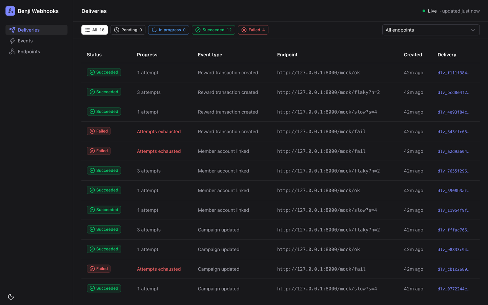
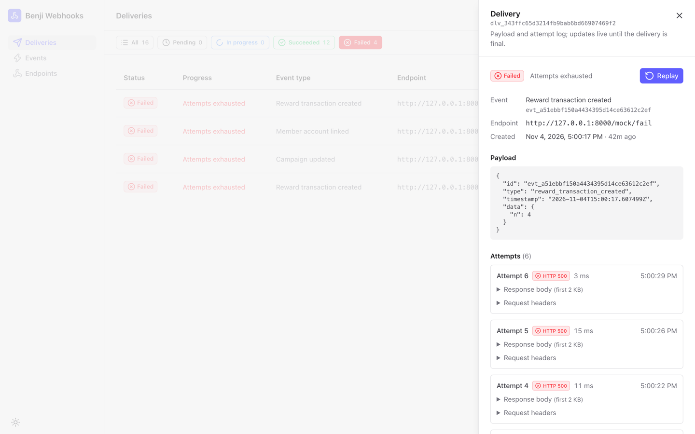
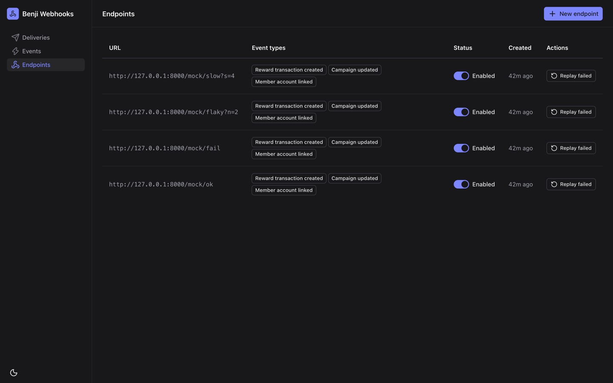
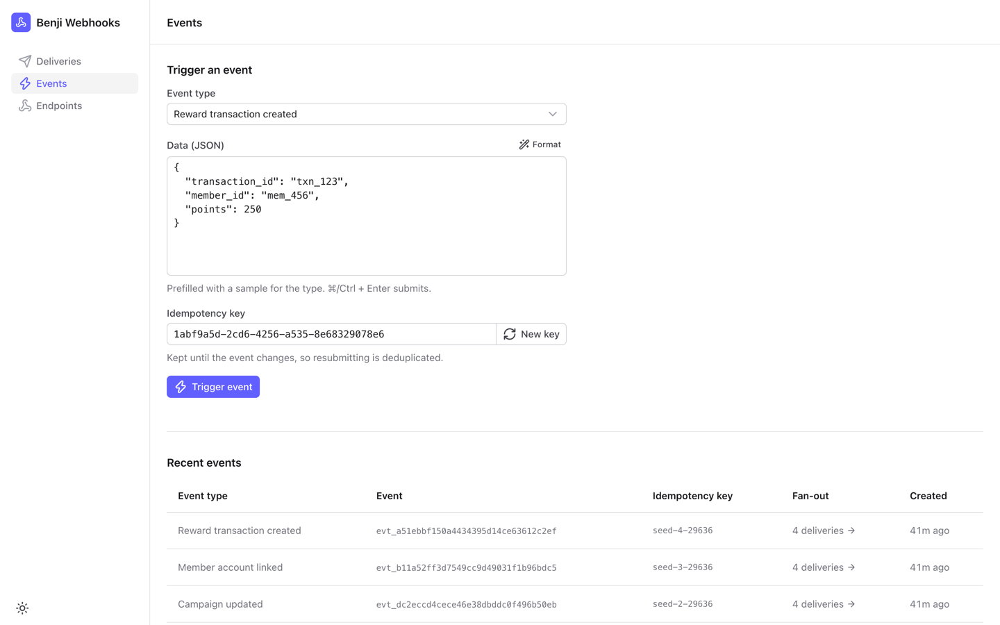

# Benji Webhooks

A webhook notification system for the Benji take-home. Customers register endpoints and subscribe them to event types. Every matching event reaches them as a signed notification, retried with backoff and safe to deduplicate. An ops dashboard shows every delivery and its attempts live.


- **Backend** (`backend/`): FastAPI and SQLite. SQLite is both the store and the delivery queue. A worker in the API process makes the deliveries, and a built-in mock receiver gives you somewhere to send them.
- **Dashboard** (`frontend/`): a Nuxt 4 SPA built with Nuxt UI and TanStack Vue Query.
- **Docs:**
  - [docs/PLAN.md](docs/PLAN.md): the design, the guarantees, what was cut, and a table tracing each requirement to its tests.
  - [GLOSSARY.md](GLOSSARY.md): the vocabulary.
  - [docs/adr/](docs/adr/): the decisions that are hard to reverse.
  - [docs/AI_USAGE.md](docs/AI_USAGE.md): how AI was used to build this.

## Prerequisites

- [uv](https://docs.astral.sh/uv/). It installs Python 3.12+ itself if you don't have it.
- Node 22 and [pnpm](https://pnpm.io/installation). With Corepack (`corepack enable`), pnpm uses the version pinned in `frontend/package.json`.
- `make`.

## Run it

Install the backend and dashboard dependencies:

```bash
cd backend && uv sync && cd ../frontend && pnpm install && cd ..
```

Start everything:

```bash
make dev
```

This serves the dashboard on <http://localhost:3000> and the API on <http://localhost:8000>, with OpenAPI docs at `/docs`. The dashboard proxies `/api` to the API, so you don't need CORS. The SQLite file is created on first start at `backend/webhooks.db`. Delete it to start fresh.

You can also start one half at a time with `make dev-backend` or `make dev-frontend`.

### Make retries visible in seconds

The defaults are production-shaped: 6 attempts per budget, with backoff from 2s up to 5 minutes. For a demo, shorten them with environment variables, or put them in `backend/.env`:

```bash
WEBHOOK_RETRY_BASE_SECONDS=1 WEBHOOK_RETRY_CAP_SECONDS=4 WEBHOOK_RETRY_MAX_ATTEMPTS=4 make dev
```

Other settings are in [settings.py](backend/src/webhooks/settings.py): `WORKER_CONCURRENCY`, `WEBHOOK_REQUEST_TIMEOUT_SECONDS`, `WEBHOOK_LEASE_SECONDS`, `MOCK_RECEIVER_ENABLED`, and others. Invalid combinations fail at startup, for example a lease that doesn't outlast the request timeout.

## Test

```bash
make lint typecheck test
```

These run ruff, strict pyright and pytest for the backend, and ESLint, `nuxt typecheck` and Vitest for the dashboard. CI ([ci.yml](.github/workflows/ci.yml)) runs the same checks on every push and PR. It also fails if the generated API client is out of date with the backend schema.

After you change the backend's API, regenerate the client with `make gen-api`.

## A 2-minute demo

Start with the fast retry settings above. The mock receiver lives on the API at `http://127.0.0.1:8000/mock/<mode>`. It verifies every signature, then answers according to its mode:

| Mode | Answer |
|---|---|
| `ok` | 200 |
| `fail` | 500, always |
| `flaky?n=3` | 500 for the first 3 requests of each delivery, then 200 |
| `slow?s=5` | waits 5 seconds, then 200, so you can watch `in progress` |

1. **Endpoints → New endpoint**: create one for `http://127.0.0.1:8000/mock/ok`, subscribed to every event type. The signing secret is shown only this once. Then add `…/mock/flaky?n=4`, `…/mock/fail` and `…/mock/slow?s=5`.
2. **Events → Trigger event**: submit the sample payload. The fan-out count links to that event's deliveries.
3. **Deliveries**: watch it live.
   - `ok` succeeds at once.
   - `slow` stays `in progress` for 5 seconds.
   - `fail` shows "attempt 2/4 · next in 3s" until it fails with *attempts exhausted*.
   - `flaky?n=4` also uses up its budget of 4, so it fails too.

   The status chips and the "Live · updated just now" indicator keep up as you watch.
4. **Open the failed `flaky` delivery**: the slideover shows the payload and each attempt's status, timing, headers and response body. Click **Replay**: the fifth request succeeds. It continues as attempt 5, under the same `webhook-id`.
5. **Deduplication**: back on Events, submit again without changing anything. The idempotency key is the same, so the dashboard shows the original event and creates no new deliveries. Changing the data gives you a new key. To see a reused key rejected, put the old key back in the key field, and the submission fails inline with 422.
6. **Disable and recover**: disable the `fail` endpoint, then trigger an event. The disabled endpoint gets no delivery. Re-enable it, then click **Replay N failed** to give all its failed deliveries a fresh budget at once.

Filters, the event drill-down and the open delivery all live in the URL, so any view can be shared or bookmarked.

## Screenshots

| Deliveries, dark | Failed delivery |
|---|---|
|  |  |
| **Endpoints** | **Events** |
|  |  |

The UI polish pass (#11) has before/after pairs in [docs/screenshots](docs/screenshots/).
